  

 

- 💼 Actualmente en **Globant**
- ⚙️ Me apasiona el **backend** y la **automatización de procesos** (n8n)
- 🌱 Aprendiendo: **Spring Boot / APIs REST**

 

  
   
  
    
  
  
  

 

| Proyecto | Descripción | Stack |
|---|---|---|
| 🛠️ [**Plataforma de Renta de Herramientas**](https://github.com/pau091/Plataforma_de_Renta_de_Herramientas) | Aplicación web para alquilar herramientas y equipos de construcción: reservas por fechas, pagos en línea, facturas y un panel distinto para administrador, proveedor y cliente. API REST con JWT, arquitectura hexagonal y 252 pruebas automatizadas. |     |
| 🚀 [**Portafolio Funcional**](https://github.com/pau091/portafolio_funcional) | Mi portafolio: quién soy, mis habilidades técnicas y un recorrido por mis proyectos de backend, bases de datos y automatización. |    |
| 🔐 [**SICA**](https://github.com/pau091/SICA) | Sistema Integrado de Control de Acceso para un complejo empresarial: registro de entradas y salidas, permisos por rol (RBAC) validados en base de datos y bitácora de auditoría inmutable. |     |

 

  
    
  
    
  

 

¿Tienes un proyecto, una vacante o una idea para automatizar? Escríbeme 💜

 

 

